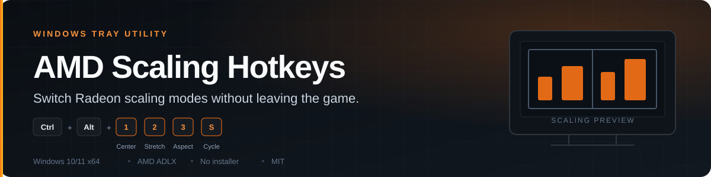

<p align="center">
  
</p>

<p align="center">
  
</p>

<h1 align="center">AMD Scaling Hotkeys</h1>

<p align="center"><strong>Switch Radeon GPU scaling modes from the keyboard.</strong><br>
A tiny Windows tray utility built on AMD's ADLX display API. No installer, no background service, and no modified game files.</p>

<p align="center">
  <a href="https://github.com/ykyritsis/amd-scaling-hotkeys/releases"><strong>Download</strong></a> &nbsp;·&nbsp;
  <a href="#hotkeys">Hotkeys</a> &nbsp;·&nbsp;
  <a href="#command-line">Command line</a> &nbsp;·&nbsp;
  <a href="#build">Build</a>
</p>

## Hotkeys

All shortcuts are global, so they work while a game is in the foreground.

| Shortcut | Mode | What it does |
| --- | --- | --- |
| `Ctrl+Alt+1` | Center | Keeps the aspect ratio with black bars around the image. |
| `Ctrl+Alt+2` | Stretch | Fills the whole panel, ignoring the source aspect ratio. |
| `Ctrl+Alt+3` | Preserve aspect ratio | Scales to fit while keeping the source shape. |
| `Ctrl+Alt+S` | Cycle | Steps through the three modes above. |

Right-click the orange **A** in the notification area to pick a monitor, switch manually, or exit. On a multi-monitor PC, use the tray menu or `AmdScaling.exe list` to find the display ID.

## What it does

- Center, Stretch (full panel), Preserve aspect ratio, and cycle modes.
- Global hotkeys that do not require the utility window to be open.
- Notification-area menu for monitor selection and manual switching.
- Embedded tray icon; the tray build opens no console window.
- Enables GPU Scaling automatically before changing the mode.
- Talks to the installed Radeon driver through `amdadlx64.dll`; it does not patch games or the driver.

## Requirements

- Windows 10 or 11, 64-bit.
- Any AMD Radeon driver that installs the 64-bit ADLX interface (`amdadlx64.dll`).
- A display that exposes scaling controls through the driver.

The utility is model-independent. Very old legacy drivers without ADLX are unsupported; update to the current Radeon driver. A copied `monitor.txt` is ignored automatically when its display ID is not present on the new PC.

## Install

Download `AmdScalingTray.exe` from [Releases](https://github.com/ykyritsis/amd-scaling-hotkeys/releases) and run it. There is no installer and no runtime dependency beyond the Radeon driver. Build artefacts are not committed to the repository.

## Run

The program lives in the notification area. Right-click its orange **A** icon to select a monitor or exit.

For an application to use the selected GPU scaling mode, it normally needs to
run in **exclusive fullscreen** at a resolution different from the monitor's
native resolution. Borderless fullscreen and windowed applications are scaled
by the Windows desktop compositor, so the driver mode may have no visible
effect. Switching modes can briefly flicker the display.

If more than one monitor is attached, use the tray menu or run `AmdScaling.exe list` to identify a display ID.

## Command line

`AmdScaling.exe` is the diagnostic console build and also works headlessly, which is handy for scripts and for diagnosing a display that refuses a mode:

```powershell
AmdScaling.exe list          # displays and their IDs
AmdScaling.exe center
AmdScaling.exe stretch
AmdScaling.exe aspect
AmdScaling.exe cycle
AmdScaling.exe tray
```

With more than one monitor attached, target a specific display with the ID reported by `list`:

```powershell
AmdScaling.exe aspect --display DISPLAY_ID_FROM_LIST
```

Keep `AmdScaling.exe` and `Start AMD Scaling Hotkeys.cmd` together if you run from a checkout. If `list` still reports Center after a mode command, the display or driver did not accept that mode.

## Build

Run `build.cmd` with the .NET Framework C# compiler. It compiles the single `Scaling.cs` twice — once as a diagnostic console build (`AmdScaling.exe`) and once as a windowless tray build (`AmdScalingTray.exe`). Both are gitignored; publish them as release assets rather than committing binaries.

See [RELEASE_NOTES.md](RELEASE_NOTES.md) for the current release highlights.

## License

MIT. AMD ADLX is an AMD API; this utility is an independent client and is not affiliated with AMD.
